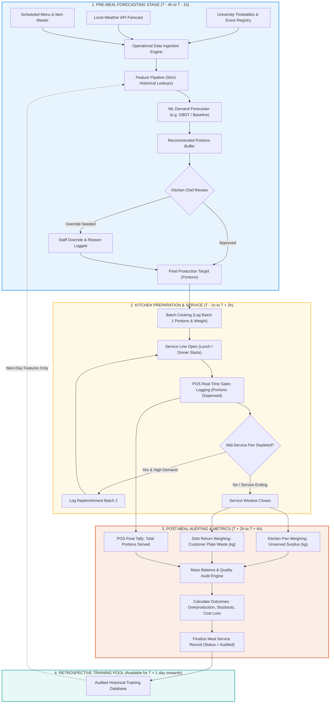

# SmartCanteen AI — Operational Forecasting Timeline & Evaluation Policy (Phase 6)

> **Document Status:** Operational Workflow, Target Definition & Evaluation Policy  
> **Target Branch:** `ml/phase-6-operational-data-pipeline`  
> **Primary Audience:** ML Engineers, Canteen Operations Team, Kitchen Supervisors  

---

## 1. Executive Summary & Operational Lifecycle

Pre-meal food demand forecasting requires an uncompromising temporal separation between **pre-meal prediction** and **post-meal auditing**:
- **Pre-Meal ($T - 4\text{ hours}$ to $T - 1\text{ hour}$):** Operational demand forecasting. Ingests student enrollment, class timetables, weather forecasts, and historical demand to recommend the exact portion count kitchen staff should cook.
- **Service Period ($T$ to $T + 2\text{ hours}$):** Diners arrive; POS registers log portions dispensed in real-time. Kitchen logs replenishment batches if needed.
- **Post-Meal ($T + 2\text{ hours}$ to $T + 4\text{ hours}$):** Operations auditing. Unserved kitchen leftovers and student plate waste are weighed and logged into the audit ledger. Realized cost loss and waste metrics are calculated.
- **Data Finalization:** Completed records are committed to the training pool only **after** the meal is completely closed and audited. Realized outcomes of a meal are **never** visible to that meal's pre-service forecast.

---

## 2. Pre-Meal to Post-Meal Operational Flowchart (Mermaid)



---

## 3. Operational Prediction Timeline & Milestones

| Timeline Milestone | Typical Time (e.g. Lunch Service 11:30–13:30) | Permitted Information Available | Prohibited Information (Strict Leakage) | Actions & Decisions |
| :--- | :--- | :--- | :--- | :--- |
| **$T - 24\text{ hours}$** | Previous Day 11:30 | Menu items scheduled, unit selling prices, historical consumption for same weekday in previous weeks. | Any same-day or future day outcomes. | Kitchen inventory requisition and raw meat thawing. |
| **$T - 4\text{ hours}$** | Service Day 07:30 | Expected student headcount from campus registry, lecture timetables, morning weather forecast (rain/temperature), cold-storage carryover leftovers. | Actual portions cooked, actual portions served, plate waste. | **Trigger ML Forecast Pipeline.** Model generates `predicted_demand_portions`. |
| **$T - 3\text{ hours}$** | Service Day 08:30 | Model recommendation and human review interface. | Sales data, dish return weights. | Kitchen Head Chef reviews forecast. Accepts or adjusts value (`final_adopted_portions`). |
| **$T - 1\text{ hour}$** | Service Day 10:30 | `Portions_Prepared` batch 1 count and gross cooked weight. | Portions served, customer waste. | Kitchen staff cooks initial batch. Food dispatched to steam tables. |
| **$T + 0\text{ hours}$** | Service Day 11:30 | Service start. Diners arrive. Real-time POS portion transactions. | Post-service waste weights. | Continuous service. POS logs transaction timestamps. |
| **$T + 2\text{ hours}$** | Service Day 13:30 | Service close. Final POS transaction count. | Historical training updates for current day. | Kitchen pans taken to scale. Tray return hopper taken to scale. |
| **$T + 3\text{ hours}$** | Service Day 14:30 | `Surplus_Unserved_kg`, `Plate_Waste_kg`, total cash reconciliation. | None (All service facts known). | Operational metrics computed: overproduction, stockouts, cost loss. |
| **$T + 4\text{ hours}$** | Service Day 15:30 | Finalized audited record committed to database (`status='Audited'`). | None. | **Service closed.** Record becomes eligible for future historical feature generation. |

---

## 4. First Forecasting Target Specification: `Expected_Demand_Portions`

### 4.1 Target Definition & Units
- **Target Name:** `Expected_Demand_Portions`
- **Unit of Measurement:** **Integer Portions** (number of standard meal servings requested and dispensed at POS).
- **Physical Meaning:** The true customer demand for a specific dish during the service window.
- **Why Portions Instead of Kilograms?**
  Chefs cook in portions, pans, and batches—not decimal kilograms. Direct portion forecasting translates immediately into kitchen action without requiring error-prone kitchen density conversions.

### 4.2 Handling Stockouts (Truncated Demand)
If a popular dish runs out 45 minutes before service ends:
$$\text{Observed Portions Served} < \text{True Customer Demand}$$
- When a stockout occurs (`Stockout_Flag = TRUE`), `Portions_Served` is right-censored.
- In early pilot phases, `Portions_Served` is recorded as the observed lower bound, and the stockout duration is logged for future Tobit/survival modeling.

### 4.3 Feature Sets: Permitted vs Prohibited

```
+-------------------------------------------------------------+
| PERMITTED PRE-MEAL FEATURES (Available at T - 4h)           |
| - Calendar: Day of week, month, academic term, holiday flag |
| - Demand Proxy: Campus expected headcount, timetable index  |
| - Weather Forecast: Temperature (°C), expected rain (mm)    |
| - Dish Context: Food category, unit price, spice level      |
| - Historical Demand: Lag 7d demand, 14d rolling mean demand |
| - Leftover Inventory: Portions carried over from lunch      |
+-------------------------------------------------------------+
                              vs
+-------------------------------------------------------------+
| PROHIBITED LEAKAGE FEATURES (Occur after T - 4h)            |
| - Portions cooked / Weight prepared                         |
| - Realized POS sales counts or sales velocity               |
| - Same-day unserved kitchen surplus                         |
| - Same-day student plate waste                              |
| - Post-meal financial loss or audit ratings                 |
+-------------------------------------------------------------+
```

### 4.4 Operational Performance Metrics

Model quality must be judged on operational canteen outcomes, not just statistical error:

1. **Portion MAE (Mean Absolute Error):**
   $$\text{MAE} = \frac{1}{N} \sum_{i=1}^N \left| \text{Actual Portions}_i - \text{Predicted Portions}_i \right|$$
2. **Overproduction (Surplus Waste Risk):**
   $$\text{Surplus Portions} = \max(0, \text{Prepared Portions} - \text{Served Portions})$$
3. **Underproduction (Stockout / Customer Dissatisfaction Risk):**
   $$\text{Stockout Deficit} = \max(0, \text{Demand Portions} - \text{Prepared Portions})$$
4. **Asymmetric Cost Loss Impact:**
   An overproduced portion loses ingredient cost ($\sim \$1.50$), while a stockout loses full retail margin ($\sim \$4.50$) plus customer goodwill. Operational evaluation must weigh underproduction penalty higher than overproduction penalty.

### 4.5 Simple Benchmark Baselines
Before deploying any complex gradient-boosted trees, two transparent, non-trainable baselines must be established:
1. **Historical Same-Weekday Same-Meal Demand Median:**
   $$\hat{y}_{d, m, i} = \text{Median}\left( \{ y_{\tau, m, i} \mid \text{Weekday}(\tau) = \text{Weekday}(d), \, \tau < d \} \right)$$
2. **Rolling 3-Week Moving Average Demand:**
   $$\hat{y}_{d, m, i} = \frac{1}{3} \sum_{k=1}^3 y_{d - 7k, m, i}$$
An ML model is only adopted if it demonstrates statistically superior operational metrics over these simple rules.

---

## 5. Holdout and Evaluation Policy

### 5.1 Reconciling the August 4–10, 2025 Holdout Discrepancy
In Phase 5, an empirical discrepancy was identified when evaluating the 7-day holdout (`2025-08-04` to `2025-08-10`, 287 records):
- **Implementation A (`history_pool`):** RF MAE was **$1.2309\text{ kg}$** vs Dummy Mean **$1.2302\text{ kg}$** ($R^2 = +0.0034$).
- **Implementation B (`train_df` strictly):** RF MAE was **$1.2182\text{ kg}$** vs Dummy Mean **$1.2302\text{ kg}$** ($R^2 = +0.0140$).

#### Technical Root Cause Reconciliation:
1. **Day 1 Identity:** On Day 1 of the holdout (August 4, 2025, 42 records), both implementations produced **identical predictions** and an identical MAE of **$1.3295\text{ kg}$** ($\Delta = 0.0000\text{ kg}$). Because August 4 has no prior holdout days, both implementations look back strictly into the training partition.
2. **Days 2–7 Rolling Window Behavior:** On August 5 through 10:
   - Under `history_pool`, rolling windows ($7\text{d}$ and $14\text{d}$) incorporate the realized waste of preceding holdout days (e.g. August 9 incorporates August 4–8). This corresponds to a **daily sequential rolling update schedule**.
   - Under `train_df`, the rolling window continues to look back strictly to August 3 and earlier. As the test window advances, recent observations drop out of the $7\text{d}$ calendar window, triggering missing-history indicator flags and substituting the fallback mean ($2.585\text{ kg}$).
   - On August 9, substituting the fallback mean happened to pull RF predictions closer to the realized targets of that specific Saturday ($1.0946\text{ kg}$ vs $1.1519\text{ kg}$), lowering the overall weekly average to $1.2182\text{ kg}$.
3. **Symmetry Across Models:**
   - Under `train_df`, regularized XGBoost MAE **degraded** from $1.2320\text{ kg}$ to $1.2332\text{ kg}$ ($R^2 = -0.0059$, worse than the baseline $1.2302\text{ kg}$).
   - Across the 4 development folds, `train_df` RF MAE averaged $1.2445\text{ kg}$, which still failed to beat the training Dummy Mean ($1.2428\text{ kg}$).

### 5.2 Mandatory Policy: The August 4–10 Holdout is Contaminated
Because the August 4–10 holdout has now been repeatedly inspected across Phases 2, 3, 4, and 5:
- **Rule 1: August 4–10, 2025 is Disqualified as a Test Set.** It must never be used for model selection, hyperparameter tuning, or validation in any future phase.
- **Rule 2: Fresh Chronological Data Required.** Future model evaluation must be performed exclusively on newly collected operational records gathered during the operational pilot, using clean, pre-registered chronological splits.
