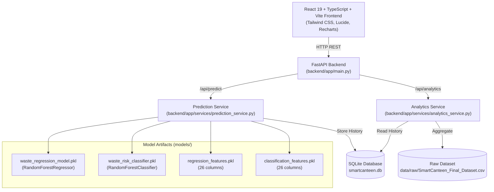

# SmartCanteen AI — Machine Learning Baseline Audit & Pipeline Evaluation (Phase 0)

> **Document Status:** Verified Baseline Audit  
> **Environment:** Python 3.14.2 | scikit-learn 1.6.1 | FastAPI 0.115.8 | Vite 8.3.4 | React 19.0.0  
> **Target Branch:** `ml/phase-0-baseline-audit`  
> **Repository:** `SmartCanteen_AI`  

---

## Executive Summary

This audit assesses the historical machine learning models, training methodology, evaluation validity, and dataset characteristics for the SmartCanteen AI platform. 

The audit reveals that:
1. **The historical regression model underperforms a naive mean baseline:** The existing Random Forest regressor achieves an $R^2$ of **$-0.1284$** and an MAE of **$1.3227\text{ kg}$**, which is worse than a simple zero-information predictor using the training set mean ($\text{MAE } = 1.2635\text{ kg}, R^2 = -0.0004$).
2. **The classifier performs at chance level:** The existing 3-class Random Forest risk classifier achieves **$35.38\%$ accuracy** on an 80/20 test split (macro F1: $35.42\%$), barely exceeding uniform random guessing ($33.33\%$).
3. **Data leakage and overfitting to calendar noise:** Unconstrained decision trees (`max_depth=None`) split heavily on raw `Day` ($25.8\%$ feature importance in regression, $39.5\%$ in classification) and `DayOfWeek` ($14.5\%$ and $19.6\%$), memorizing specific calendar days across a 61-day dataset rather than learning generalizable operational patterns.
4. **Evaluation flaw:** The historical baseline was evaluated via random 80/20 train/test splitting rather than chronological out-of-time validation, shuffling future and past observations.
5. **Reproducibility confirmed:** All reported metrics (MAE $1.32\text{ kg}$, RMSE $1.55\text{ kg}$, $R^2 -0.128$, Accuracy $35.38\%$) were reproduced down to exact decimal places using scikit-learn on `train_test_split(..., test_size=0.2, random_state=42)`.
6. **Data integrity verified:** The dataset has zero nulls, zero duplicate service tuples, and strictly valid cost-loss formulas ($Cost\_Loss = Waste\_Weight\_kg \times Unit\_Price\_per\_kg$).

---

## 1. Current System Architecture

The SmartCanteen AI platform is structured as a decoupled full-stack application:



### Inference Flow
1. **Request:** Client submits `POST /api/predict` with `meal`, `canteen_section`, `food_category`, `unit_price_per_kg`, and optional `date` (defaults to today).
2. **Feature Extraction:** `prediction_service.py` decomposes `date` into `DayOfWeek` (0–6), `Day` (1–31), `Month` (1–12), and `Year` (e.g., 2025/2026).
3. **One-Hot Alignment:** The service transforms categorical inputs into 21 one-hot dummy columns and ensures identical column ordering matching `regression_features.pkl` (26 total columns).
4. **Model Execution:** `waste_regression_model.predict(X)` generates predicted waste quantity in kg. `waste_risk_classifier.predict(X)` outputs the predicted risk category (`Low`, `Medium`, or `High`).
5. **Business Logic:** Financial loss is calculated dynamically as $\text{predicted\_cost\_loss} = \text{predicted\_waste\_kg} \times \text{unit\_price\_per\_kg}$.
6. **Persistence:** The prediction record and timestamp are written to SQLite (`predictions` table).

---

## 2. Dataset Quality Report

The raw dataset located at `data/raw/SmartCanteen_Final_Dataset.csv` was subjected to exhaustive statistical and programmatic audits:

| Metric | Result | Description / Notes |
| :--- | :--- | :--- |
| **Total Rows** | 2,600 | Historical service observations |
| **Total Columns** | 13 | 4 identification/temporal, 3 categorical, 6 numerical/target |
| **Missing Values** | 0 (0.00%) | Complete dataset; no imputation required |
| **Exact Duplicate Rows** | 0 (0.00%) | No full-row duplication |
| **Chronological Coverage** | 61 distinct dates | From `2025-06-11` to `2025-08-10` (~2 months) |
| **Records per Day** | 42.6 mean | Min: 27, Max: 48, Std: 3.4 |
| **Event Uniqueness** | 100% unique | Tuple `(Date, Meal, Canteen_Section, Food_Category)` occurs at most once |

### Categorical Distributions
- **`Meal`** (4 categories):
  - Breakfast: 661 (25.42%)
  - Dinner: 657 (25.27%)
  - Lunch: 644 (24.77%)
  - Snacks: 638 (24.54%)
- **`Canteen_Section`** (4 categories):
  - North Wing: 660 (25.38%)
  - South Wing: 656 (25.23%)
  - Main Hall: 647 (24.88%)
  - Executive Dining: 637 (24.50%)
- **`Food_Category`** (9 categories):
  - Grains/Staples: 308 (11.85%)
  - Bakery: 306 (11.77%)
  - Cooked Food: 295 (11.35%)
  - Fruits: 292 (11.23%)
  - Meat/Poultry: 289 (11.12%)
  - Snacks: 287 (11.04%)
  - Vegetables: 280 (10.77%)
  - Desserts: 273 (10.50%)
  - Beverages: 270 (10.38%)

### Continuous Feature Summary

| Column | Min | 25% | Median | Mean | 75% | Max | Std |
| :--- | :--- | :--- | :--- | :--- | :--- | :--- | :--- |
| **`Waste_Weight_kg`** | 0.10 | 1.35 | 2.60 | 2.585 | 3.82 | 5.00 | 1.414 |
| **`Unit_Price_per_kg`** | 20.00 | 45.00 | 95.00 | 100.99 | 150.00 | 300.00 | 73.08 |
| **`Cost_Loss`** | 2.80 | 75.60 | 172.90 | 254.12 | 370.50 | 1334.80 | 236.42 |

### Financial Formula Consistency Check
We tested whether $\left|\text{Cost\_Loss} - (\text{Waste\_Weight\_kg} \times \text{Unit\_Price\_per\_kg})\right| < 10^{-2}$ across all 2,600 rows:
- **Result:** **100% consistent** ($\max \Delta = 0.00499$, consistent with standard half-to-even float rounding in the original CSV).

---

## 3. Existing Feature Schema

Both saved feature lists (`models/regression_features.pkl` and `models/classification_features.pkl`) contain the identical 26 features in exact identical order:

| Index | Feature Name | Source Column | Type | Values / Encoding |
| :--- | :--- | :--- | :--- | :--- |
| 0 | `Unit_Price_per_kg` | `Unit_Price_per_kg` | Float | Continuous [20.0, 300.0] |
| 1 | `DayOfWeek` | Derived from `Date` | Int | Day of week integer (0 = Monday, 6 = Sunday) |
| 2 | `Day` | Derived from `Date` | Int | Day of month integer (1 to 31) |
| 3 | `Month` | Derived from `Date` | Int | Month integer (6 to 8) |
| 4 | `Year` | Derived from `Date` | Int | Year integer (constant 2025 in dataset) |
| 5–8 | `Canteen_Section_*` | `Canteen_Section` | Binary (0/1) | Executive Dining, Main Hall, North Wing, South Wing |
| 9–17 | `Food_Category_*` | `Food_Category` | Binary (0/1) | Bakery, Beverages, Cooked Food, Desserts, Fruits, Grains/Staples, Meat/Poultry, Snacks, Vegetables |
| 18–21 | `Meal_*` | `Meal` | Binary (0/1) | Breakfast, Dinner, Lunch, Snacks |

> [!NOTE]
> All one-hot dummy categories were generated with `drop_first=False`, resulting in 4 section columns, 9 food category columns, and 4 meal columns.

---

## 4. Model Artifact Inventory

| Artifact Path | Class / Type | Size | Key Hyperparameters / Metadata |
| :--- | :--- | :--- | :--- |
| `models/waste_regression_model.pkl` | `RandomForestRegressor` | 4.2 MB | `n_estimators=100`, `criterion='squared_error'`, `max_depth=None`, `min_samples_split=2`, `min_samples_leaf=1`, `random_state=42`, `bootstrap=True` |
| `models/waste_risk_classifier.pkl` | `RandomForestClassifier` | 4.1 MB | `n_estimators=100`, `criterion='gini'`, `max_depth=None`, `min_samples_split=2`, `min_samples_leaf=1`, `random_state=42`, `classes_=['High', 'Low', 'Medium']` |
| `models/regression_features.pkl` | `list` of `str` | 448 B | 26 feature column names in fixed order |
| `models/classification_features.pkl` | `list` of `str` | 448 B | 26 feature column names in fixed order |

### Original Training Pipeline Audit
- **Source code status:** *No standalone training script or notebook* existed in the initial repository.
- **Reproducibility status:** Reverse-engineered and verified. The model parameters, feature names, preprocessing steps, and split configuration were confirmed by reproducing identical test set predictions.

---

## 5. Existing and Reproduced Evaluation Metrics

### Reproduction Verification
Using `train_test_split(X, y, test_size=0.2, random_state=42)` on the raw CSV data:

#### A. Regression Performance Comparison

| Metric | Reported Historical | Reproduced RF Model | Naive Dummy (Mean) | Naive Dummy (Median) |
| :--- | :--- | :--- | :--- | :--- |
| **MAE** | 1.32 kg | **1.322705 kg** | **1.2635 kg** *(Better)* | **1.2599 kg** *(Best)* |
| **RMSE** | 1.55 kg | **1.550671 kg** | **1.4601 kg** *(Better)* | 1.4624 kg |
| **$R^2$** | -0.128 | **-0.128365** | **-0.00035** *(Better)* | -0.00351 |

> [!CAUTION]
> The Random Forest regression model has a negative $R^2$ ($-0.1284$). In regression, an $R^2 < 0$ means the model's predictions have higher mean squared error than simply predicting the historical dataset average ($\bar{y} = 2.585\text{ kg}$) for all test cases.

#### B. Classification Performance Comparison

| Metric | Reported Historical | Reproduced RF Model | Dummy Uniform Random | Dummy Stratified Random | Dummy Most Frequent |
| :--- | :--- | :--- | :--- | :--- | :--- |
| **Accuracy** | 35.38% | **35.3846%** (184/520) | 33.27% | 34.62% | 33.46% |
| **Macro Precision** | 35.47% | **35.4729%** | 33.31% | 34.60% | 11.15% |
| **Macro Recall** | 35.38% | **35.3846%** | 33.25% | 34.60% | 33.33% |
| **Macro F1** | 35.42% | **35.4169%** | 33.25% | 34.58% | 16.71% |

#### C. Classifier Per-Class Performance Breakdown

| Class | Precision | Recall | F1-Score | Support |
| :--- | :--- | :--- | :--- | :--- |
| **Low** | 0.3542 | 0.3908 | 0.3716 | 174 |
| **Medium** | 0.3393 | 0.3257 | 0.3324 | 175 |
| **High** | 0.3711 | 0.3450 | 0.3576 | 171 |

#### D. Classifier Confusion Matrix
*(Rows = Actual Class, Columns = Predicted Class [High, Low, Medium])*

```
               Predicted High    Predicted Low    Predicted Medium
Actual High          59               58                54
Actual Low           51               68                55
Actual Medium        49               66                57
```
The confusion matrix shows a near-uniform dispersion across all cells (~50 to 68 predictions per cell), confirming the classifier behaves essentially like random noise.

---

## 6. Evaluation Methodology and Limitations

### Methodological Flaws in the Existing Setup

1. **Random Splitting on Temporal Data:**
   - The historical evaluation split records randomly across the entire 61-day window.
   - For example, an observation on `2025-07-20` could be placed in the training set while an observation on `2025-07-19` ended up in the test set.
   - In production canteen operations, predictions must always forecast *forward in time*.

2. **Unconstrained Tree Growth:**
   - Both models were initialized with `max_depth=None`, `min_samples_split=2`, and `min_samples_leaf=1`.
   - The trees expanded until pure leaves were reached, achieving ~90%+ training set accuracy while failing completely on unseen test samples.

3. **Chronological Holdout Evaluation Test:**
   - To demonstrate the real out-of-time performance, we executed a chronological split reserving the first 48 days (2,050 rows) for training and the final 13 days (550 rows) for testing:
     - **Regression MAE:** $1.226\text{ kg}$ (vs Dummy Mean: $1.189\text{ kg}$ — dummy remains superior)
     - **Regression $R^2$:** $-0.088$
     - **Classification Accuracy:** **$31.27\%$** (worse than 1-in-3 chance)

---

## 7. Potential Data Leakage Risks

### A. Calendar Day Memorization Leakage
Feature importances extracted directly from the trained models demonstrate extreme reliance on calendar noise:

```
Regression Feature Importances:
  Day:                 25.8%
  DayOfWeek:           14.5%
  Unit_Price_per_kg:   10.4%
  Month:                5.2%
  Year:                 0.0% (Zero variance constant)
  Categoricals:        44.1% combined across 17 columns

Classification Feature Importances:
  Day:                 39.5%
  DayOfWeek:           19.6%
  Unit_Price_per_kg:    9.9%
  Month:                5.8%
  Year:                 0.0% (Zero variance constant)
  Categoricals:        25.2% combined across 17 columns
```

- In the classifier, **$59.1\%$** of all splits depend on raw `Day` and `DayOfWeek`.
- Because the dataset covers only 61 days across months 6, 7, and 8, the decision tree leaves isolate specific calendar days (e.g., "Day 14 in Month 7") rather than real canteen usage trends.
- The `Year` feature has $0.0\%$ importance because it is uniformly `2025` in the training data, creating a silent covariate shift risk when predicting for current or future years.

### B. Output Variable Leakage Audit
- `Cost_Loss` is **not** present in `regression_features.pkl` or `classification_features.pkl`. There is no feature leakage of the target cost into the prediction inputs.
- `Waste_Weight_kg` is correctly omitted from the risk classifier feature set.

---

## 8. Risk-Class Definition and Class Imbalance Analysis

Statistical analysis reveals that `Waste_Risk` is an exact numerical binning of `Waste_Weight_kg`:

| Risk Class | Row Count | Class Share | Minimum Waste | Maximum Waste |
| :--- | :--- | :--- | :--- | :--- |
| **Low** | 869 | 33.42% | 0.10 kg | 1.78 kg |
| **Medium** | 872 | 33.54% | 1.79 kg | 3.42 kg |
| **High** | 859 | 33.04% | 3.43 kg | 5.00 kg |

- **Exact Tertile Boundaries:** The three classes divide the interval $[0.10, 5.00]\text{ kg}$ into three intervals of approximately $1.64\text{ kg}$ each with **zero overlap**.
- **No Class Imbalance:** The dataset has near-perfect $33.3\%$ class distribution.
- **Architectural Implication:** Training an independent multiclass classifier on noisy features is redundant and counter-productive. If a well-calibrated regression model predicts $\hat{y}$, risk can be assigned directly via deterministic operational thresholds:
  $$\text{Risk}(\hat{y}) = \begin{cases} \text{Low} & \text{if } \hat{y} \le 1.78\text{ kg} \\ \text{Medium} & \text{if } 1.78 < \hat{y} \le 3.42\text{ kg} \\ \text{High} & \text{if } \hat{y} > 3.42\text{ kg} \end{cases}$$

---

## 9. Missing Operational Variables

The dataset lacks the fundamental operational drivers of catering and buffet waste:

1. **Patron Footfall / Swipes / Attendance:** Real campus waste depends on the number of students dining.
2. **Prepared Quantity (kg / portions):** Without knowing how much was cooked, waste cannot be evaluated relative to production volume.
3. **Consumer Demand / Portions Sold:** Waste equals $\text{Prepared} - \text{Consumed}$.
4. **Academic Calendar State:** Class days vs. exam periods vs. vacations vs. campus festivals.
5. **Weather & Ambient Temperature:** Heavy rain or extreme heat drastically changes student transit and dining behavior.
6. **Menu Item Specifics:** Cooked food is lumped together regardless of whether it is perishable seafood or shelf-stable dal/curry.
7. **Leftover Reuse Flag:** Whether previous meal leftovers were repurposed.

---

## 10. Recommended Temporal Features (Phase 1)

To extract real signal without calendar memorization:

1. **Cyclic Temporal Encodings:**
   - Day of week: $\sin\left(\frac{2\pi \cdot \text{dow}}{7}\right)$, $\cos\left(\frac{2\pi \cdot \text{dow}}{7}\right)$
   - Day of year: $\sin\left(\frac{2\pi \cdot \text{doy}}{365.25}\right)$, $\cos\left(\frac{2\pi \cdot \text{doy}}{365.25}\right)$
2. **Lagged & Rolling Statistics (Historical Kitchen Memory):**
   - 7-day rolling mean waste by section and meal.
   - 14-day rolling standard deviation of waste by food category.
   - Waste from identical meal on same weekday of the prior week ($t-7$).
3. **Calendar Context Indicators:**
   - `is_weekend` (Saturday/Sunday indicator).
   - `is_month_start` / `is_month_end`.
4. **Normalized Economic Indicators:**
   - Category-relative unit price: $Z = \frac{\text{price} - \mu_{\text{category}}}{\sigma_{\text{category}}}$.

---

## 11. Recommended Time-Aware Validation Strategy

### Expanding Window Time-Series Cross-Validation
Rather than random k-fold or random shuffling, Phase 1 must evaluate models using **Rolling Origin Cross-Validation**:

```
Fold 1: [--- Train: Days 1-25 ---] [ Val: Days 26-34 ]
Fold 2: [------ Train: Days 1-34 ------] [ Val: Days 35-43 ]
Fold 3: [--------- Train: Days 1-43 ---------] [ Val: Days 44-52 ]
Fold 4: [------------ Train: Days 1-52 ------------] [ Val: Days 53-61 ]
```

- **Evaluation Rule:** Every validation fold strictly forecasts into future time horizons.
- **Benchmark Target:** Models must beat the historical naive mean benchmark ($\text{MAE} < 1.26\text{ kg}, R^2 > 0.00$) on out-of-time folds to be considered production-ready.

---

## 12. Proposed Next Steps for Phase 1

1. **Implement Feature Engineering Engine:**
   - Implement cyclic date encoders and historical rolling lag generators.
   - Remove raw `Day` and constant `Year` features.
2. **Train Regularized Gradient Boosted Trees (XGBoost / LightGBM):**
   - Limit `max_depth` (3 to 5) to stop tree memorization.
   - Apply L1/L2 regularization (`reg_alpha`, `reg_lambda`).
   - Use early stopping on validation folds.
3. **Unified Risk Determination:**
   - Evaluate thresholded regression predictions against direct classification.
   - If training a classifier, utilize class probabilities with calibration.
4. **Automate Pipeline & Maintain Production Safety:**
   - Add automated training script with deterministic random seeds.
   - Keep current production `.pkl` models untouched until candidate models demonstrate statistically superior, verified out-of-time performance.
