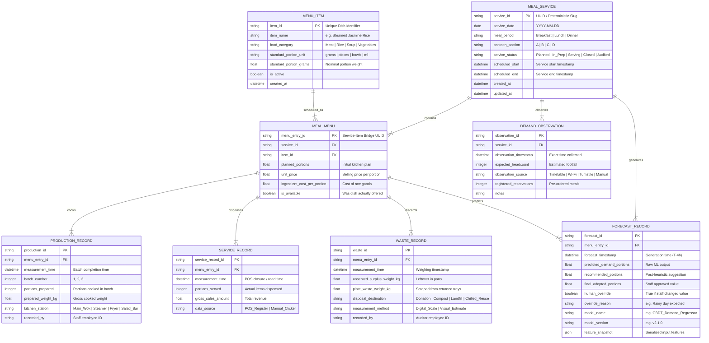

# SmartCanteen AI — Relational Operational Data Model (Phase 6)

> **Document Status:** Operational Data Architecture & Schema Proposal  
> **Target Branch:** `ml/phase-6-operational-data-pipeline`  
> **Scope:** Proposed operational database design for institutional kitchen food demand forecasting  
> **Production Safety Note:** This schema is a design proposal for future implementation. The existing SQLite production database (`prediction_history`) remains untouched.

---

## 1. Executive Summary & Design Principles

The Phase 5 audit proved that the existing repository dataset is fundamentally insufficient for pre-meal forecasting because it lacks operational volume features (headcount, portions cooked, portions served, and carried-over inventory).

This document proposes a **normalized, relational operational schema** designed to support:
1. **Physical Mass & Portion Tracking:** Accounting for food through each transformation stage: *Planned $\rightarrow$ Prepared $\rightarrow$ Served $\rightarrow$ Discarded / Donated*.
2. **Strict Temporal Integrity:** Enforcing immutable timestamps on all observations to prevent retroactive leakage into pre-meal features.
3. **Auditability & Human Overrides:** Recording both automated model forecasts and kitchen staff manual overrides.
4. **Relational Isolation:** Ensuring records from different dates, meal periods, and canteen sections cannot be cross-contaminated.

---

## 2. Entity-Relationship Diagram (Mermaid)

---

## 3. Relational Entity Specifications

### 3.1 `Meal_Service`
Represents an individual meal event at a specific canteen section on a specific calendar day.
- **`service_id` (VARCHAR(64), PK):** Unique deterministic slug, e.g., `2026-10-21_Lunch_Section_A`.
- **`service_date` (DATE, NOT NULL):** Calendar date (ISO YYYY-MM-DD).
- **`meal_period` (VARCHAR(16), NOT NULL):** Check constraint: `IN ('Breakfast', 'Lunch', 'Dinner')`.
- **`canteen_section` (VARCHAR(16), NOT NULL):** Check constraint: `IN ('A', 'B', 'C', 'D')`.
- **`service_status` (VARCHAR(16), NOT NULL):** State machine: `Planned` $\rightarrow$ `In_Prep` $\rightarrow$ `Serving` $\rightarrow$ `Closed` $\rightarrow$ `Audited`.
- **Constraints:** `UNIQUE(service_date, meal_period, canteen_section)`. Guarantees zero duplicate meal events.

### 3.2 `Menu_Item`
Master dish catalog specifying standard portion semantics.
- **`item_id` (VARCHAR(32), PK):** Slug, e.g., `braised_chicken_thigh`.
- **`item_name` (VARCHAR(128), NOT NULL):** Human-readable name.
- **`food_category` (VARCHAR(32), NOT NULL):** Check constraint: `IN ('Meat', 'Rice', 'Soup', 'Vegetables')`.
- **`standard_portion_unit` (VARCHAR(16), NOT NULL):** Standard unit (`grams`, `pieces`, `bowls`).
- **`standard_portion_grams` (FLOAT, NOT NULL):** Nominal cooked mass per portion (e.g. $180.0\text{ g}$).

### 3.3 `Meal_Menu`
Associative table linking menu items to a specific meal service with pricing and planned quantities.
- **`menu_entry_id` (VARCHAR(64), PK):** UUID.
- **`service_id` (VARCHAR(64), FK $\rightarrow$ `Meal_Service.service_id`, NOT NULL):** Cascades on delete.
- **`item_id` (VARCHAR(32), FK $\rightarrow$ `Menu_Item.item_id`, NOT NULL):**
- **`planned_portions` (INTEGER, NOT NULL):** Initial portion target planned by head chef.
- **`unit_price` (DECIMAL(6,2), NOT NULL):** Retail menu price per portion ($> 0.0$).
- **`ingredient_cost_per_portion` (DECIMAL(6,2), NOT NULL):** Procurement cost ($> 0.0$).
- **Constraints:** `UNIQUE(service_id, item_id)`. Prevents scheduling the same item twice in one service.

### 3.4 `Demand_Observation`
Time-stamped external observations of expected student demand and headcount.
- **`observation_id` (VARCHAR(64), PK):** UUID.
- **`service_id` (VARCHAR(64), FK $\rightarrow$ `Meal_Service.service_id`, NOT NULL):**
- **`observation_timestamp` (DATETIME, NOT NULL):** Exactly when the observation was ingested.
- **`expected_headcount` (INTEGER, NOT NULL):** Estimated footfall ($\ge 0$).
- **`observation_source` (VARCHAR(32), NOT NULL):** `Timetable_Schedule`, `WiFi_Density`, `Pre_Order_System`, `Manual_Estimate`.
- **`registered_reservations` (INTEGER, DEFAULT 0):** Confirmed pre-orders.

### 3.5 `Production_Record`
Actual batch cooking logs submitted by kitchen staff.
- **`production_id` (VARCHAR(64), PK):** UUID.
- **`menu_entry_id` (VARCHAR(64), FK $\rightarrow$ `Meal_Menu.menu_entry_id`, NOT NULL):**
- **`measurement_time` (DATETIME, NOT NULL):** Batch completion time.
- **`batch_number` (INTEGER, NOT NULL):** Sequential batch (1 for initial prep, 2+ for replenishment).
- **`portions_prepared` (INTEGER, NOT NULL):** Count of portions cooked in this batch ($> 0$).
- **`prepared_weight_kg` (FLOAT, NULLABLE):** Measured gross cooked weight in kilograms.
- **`recorded_by` (VARCHAR(32), NOT NULL):** Staff badge identifier.

### 3.6 `Service_Record`
Point-of-Sale (POS) actual meal transaction tallies.
- **`service_record_id` (VARCHAR(64), PK):** UUID.
- **`menu_entry_id` (VARCHAR(64), FK $\rightarrow$ `Meal_Menu.menu_entry_id`, NOT NULL):**
- **`measurement_time` (DATETIME, NOT NULL):** POS register tally timestamp.
- **`portions_served` (INTEGER, NOT NULL):** Number of portions purchased by diners ($\ge 0$).
- **`gross_sales_amount` (DECIMAL(8,2), NOT NULL):** Reconciled revenue.
- **`data_source` (VARCHAR(32), NOT NULL):** `POS_Export` or `Manual_Audit`.

### 3.7 `Waste_Record`
Post-service audit separating kitchen surplus from plate scrap.
- **`waste_id` (VARCHAR(64), PK):** UUID.
- **`menu_entry_id` (VARCHAR(64), FK $\rightarrow$ `Meal_Menu.menu_entry_id`, NOT NULL):**
- **`measurement_time` (DATETIME, NOT NULL):** Scale measurement timestamp.
- **`unserved_surplus_weight_kg` (FLOAT, NOT NULL):** Weight of unserved food remaining in warming pans ($\ge 0.0$).
- **`plate_waste_weight_kg` (FLOAT, NOT NULL):** Weight of uneaten food scraped into disposal hoppers ($\ge 0.0$).
- **`disposal_destination` (VARCHAR(32), NOT NULL):** `Compost`, `Donation`, `Biofuel`, `Chilled_Reuse`, `Landfill`.
- **`measurement_method` (VARCHAR(32), NOT NULL):** `Digital_Bench_Scale`, `Floor_Scale`, `Visual_Bucket_Estimate`.

### 3.8 `Forecast_Record`
Audit trail of machine learning predictions, feature snapshots, and human overrides.
- **`forecast_id` (VARCHAR(64), PK):** UUID.
- **`menu_entry_id` (VARCHAR(64), FK $\rightarrow$ `Meal_Menu.menu_entry_id`, NOT NULL):**
- **`forecast_timestamp` (DATETIME, NOT NULL):** Exact time model was executed (must be $< \text{scheduled\_start} - 2\text{h}$).
- **`predicted_demand_portions` (FLOAT, NOT NULL):** Raw model inference output.
- **`recommended_portions` (INTEGER, NOT NULL):** Rounded buffer recommendation.
- **`final_adopted_portions` (INTEGER, NOT NULL):** Number kitchen actually agreed to prepare.
- **`human_override` (BOOLEAN, NOT NULL):** `TRUE` if `final_adopted_portions != recommended_portions`.
- **`override_reason` (VARCHAR(255), NULLABLE):** Explanation for manual adjustment.
- **`model_name` (VARCHAR(64), NOT NULL):** Model architecture identifier.
- **`model_version` (VARCHAR(32), NOT NULL):** Model version or git commit hash.
- **`feature_snapshot` (JSON, NOT NULL):** Complete JSON payload of features used at prediction time for perfect reproducibility.

---

## 4. Architectural Trade-offs & Isolation Guarantees

1. **Normalized Bridge (`Meal_Menu`) vs Flat Rows:**
   - *Design Choice:* We use `Meal_Menu` as a child of `Meal_Service` and parent to `Production`, `Service`, `Waste`, and `Forecast` records.
   - *Trade-off:* Requires joins for flat analytical queries.
   - *Advantage:* Guarantees zero duplicate facts. Impossible for a chicken production record in Section A to attach to a beef service record in Section B.
2. **Multiple Production Batches vs Single Total:**
   - *Design Choice:* `Production_Record` supports multiple batches per dish (`batch_number`).
   - *Advantage:* Modern canteens practice batch cooking (cooking 60% initially and replenishment batches as demand emerges). Capturing batch counts enables training dynamic intra-meal replenishment policies.
3. **Audit Trail Immutability:**
   - Observations, predictions, and measurements are append-only.
   - Corrections do not overwrite existing rows; they append a correction record with `superseded_by_id`.
4. **Complete Isolation from Live SQLite DB:**
   - The production app uses SQLite (`database.db`) storing `prediction_history` with flat legacy columns.
   - This relational schema proposal lives purely in documentation and does not alter production tables.

---

## 5. Measurement Boundary Caveats

### Why Pure Mass Balance Cannot Be Enforced Universally
In naive modeling, one might expect:
$$\text{Weight Prepared} = \text{Weight Served} + \text{Weight Surplus} + \text{Weight Plate Waste}$$
**In real kitchen operations, this strict equality frequently fails due to physical measurement boundaries:**
1. **Evaporative Moisture Loss:** Hot holding pans continuously lose moisture ($2\%\text{--}8\%$ of mass over a 2-hour lunch window).
2. **Serving Tare & Sauce Drips:** Ladles, buffet pan rims, and counter spills cause unmeasured losses.
3. **Plate Waste Non-Food Contamination:** Customer trays contain napkins, toothpicks, garnish bones, and liquids that alter disposal scale readings.
4. **Unit Incongruity:** Cash registers record *portion counts* (e.g. 1 bowl of rice), while scales record *kilograms*. Portion sizing varies by kitchen server ladle fullness.

**Rule:** Validation rules must check for physical plausibility (e.g. $\text{Surplus} \le 1.1 \times \text{Prepared}$), but must **never** reject records simply because evaporative shrinkage breaks exact zero-sum mass balance.
